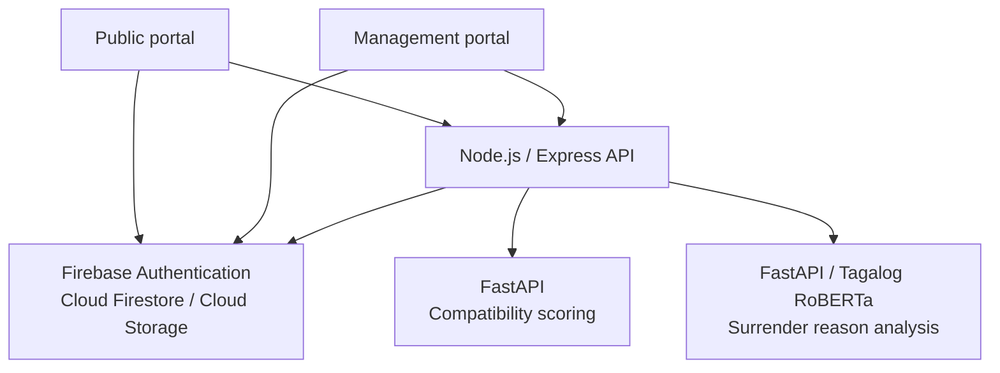

  

<h1 align="center">ANIMUA</h1>

  <strong>Animal adoption and shelter management for the Angeles City Veterinary Office.</strong>

  <a href="#overview">Overview</a> &nbsp;·&nbsp;
  <a href="#product-tour">Product tour</a> &nbsp;·&nbsp;
  <a href="#system-architecture">Architecture</a> &nbsp;·&nbsp;
  <a href="#repository-guide">Repository guide</a>

ANIMUA connects residents seeking to adopt or surrender an animal with the shelter personnel responsible for its care. It brings public applications, animal records, compatibility matching, and shelter operations into one system, following each animal from intake through placement.

## Overview

The system has two web portals backed by a shared API and Firebase services.

| Portal | Audience | Main capabilities |
| --- | --- | --- |
| **Public portal** | Residents and prospective adopters | Browse adoptable animals, review profiles, complete the English or Tagalog compatibility quiz, submit adoption or surrender requests, and track applications and appointments. |
| **Management portal** | Authorized shelter personnel | Review requests, manage intake and animal care, coordinate adoptions, monitor inventory, publish announcements, and review reports and audit history. |

### How the workflows connect

1. **Request and intake.** Residents submit surrender requests with animal details and supporting information. Personnel review the request, coordinate an appointment, confirm arrival, and convert an eligible request into an intake record. Intake also supports animals arriving through other recorded sources.
2. **Care and adoption readiness.** Intake records become animal profiles. Personnel maintain behavioral assessments, medical records, quarantine status, and veterinary clearance before marking an animal ready for adoption.
3. **Discovery and placement.** Residents browse available animals or use compatibility recommendations, then apply to adopt. Personnel review applications, coordinate pickup, confirm attendance, and finalize the adoption while preserving application history.

Inventory, announcements, contact conversations, notifications, reports, and audit records support these workflows across both portals.

## Product tour

The selected screens show the public experience and the workspaces used to manage shelter operations. Screenshots use illustrative animal, application, and inventory records.

### Animal discovery and compatibility

Residents can search and filter available animals, explore their care needs, and use a bilingual questionnaire to find suitable matches.

<table>
  <tr>
    <td width="50%" valign="top">
      <strong>Find Furbabies</strong> 
      Searchable animal cards with identifying details, readiness indicators, and profile and adoption actions.
        
      
    </td>
    <td width="50%" valign="top">
      <strong>Compatibility quiz</strong> 
      Guided English and Tagalog questions covering preferences, lifestyle, household, and care expectations.
        
      
    </td>
  </tr>
</table>

### Shelter visibility and animal care

The management portal connects shelter summaries with the records and lifecycle stages behind them.

<table>
  <tr>
    <td width="50%" valign="top">
      <strong>Management dashboard</strong> 
      Shelter population, intake and adoption activity, species distribution, and operational priorities.
        
      
    </td>
    <td width="50%" valign="top">
      <strong>Animal profiling</strong> 
      Animal records organized by care status, with intake context, housing, and access to complete profiles.
        
      
    </td>
  </tr>
</table>

### Request review and resource planning

Personnel can prioritize incoming requests and assess supply needs using operational records and supporting analysis.

<table>
  <tr>
    <td width="50%" valign="top">
      <strong>Surrender management</strong> 
      Review queues with reason categories, urgency indicators, appointment information, and request status.
        
      
    </td>
    <td width="50%" valign="top">
      <strong>Inventory management</strong> 
      Stock availability, movement classification, low-stock alerts, and estimated days of supply.
        
      
    </td>
  </tr>
</table>

### Operational reporting

The Reports Center brings shelter datasets into a common workspace with date and barangay filters, record summaries, and PDF and Excel exports.

Additional views: [Animal profile](docs/screenshots/public-animal-profile.jpg) · [My Applications](docs/screenshots/my-applications.jpg) · [Public surrender](docs/screenshots/public-surrender.jpg) · [Announcements](docs/screenshots/public-announcements.jpg).

## System architecture

Both portals are Vite-built, multi-page applications written in HTML, CSS, and JavaScript. They use Firebase client SDKs for authentication and selected live data access. The Express API handles protected operations, workflow validation, audit logging, and communication with the Python services.

| Component | Technologies | Responsibility |
| --- | --- | --- |
| Web portals | HTML, CSS, JavaScript, Vite, Firebase Web SDK | Public and management interfaces, browser authentication, and selected live data views. |
| Application API | Node.js **24.x (24.22.1 or newer)**, Express, Firebase Admin SDK | Access checks, business rules, request lifecycles, file handling, and service integration. |
| Data and identity | Firebase Authentication, Cloud Firestore, Cloud Storage | Authentication, application and shelter records, uploaded photos, and supporting files. |
| Compatibility service | Python, FastAPI | Compare questionnaire preferences with recorded behavioral traits and return ranked matches. |
| Surrender analysis | Python, FastAPI, Transformers, PyTorch | Analyze surrender reasons with Tagalog RoBERTa models and supporting categorization and urgency rules. |
| Inventory analysis | Random Forest classifier in the Node backend | Classify stock movement and combine current inventory with stockout calculations. |
| Reporting and verification | pdfmake, ExcelJS, Node test runner, Vitest, Cypress | Document exports, automated checks, and browser workflow coverage. |

### Design details

- **Workflow rules live in the API.** Role checks and lifecycle validation control actions such as approving a request, converting a surrender into intake, and finalizing an adoption.
- **Matching uses recorded animal traits.** The scoring service compares questionnaire preferences with behavioral assessment dimensions; recorded care status determines special-needs eligibility separately.
- **Analysis supports staff review.** Surrender categories and urgency indicators assist the review queue. Approval and intake conversion remain explicit personnel actions.
- **Service failures have fallbacks.** The Node backend provides local compatibility scoring and rule-based surrender analysis when the corresponding Python service is unavailable.
- **Operational history stays connected.** Application status, appointments, notifications, and audit records preserve context across public submissions and management actions.

## Repository guide

| Location | What to explore |
| --- | --- |
| [`frontend/`](frontend/) | Public pages, animal discovery, compatibility quiz, applications, and shared browser services. |
| [`admin-frontend/`](admin-frontend/) | Management pages for animal care, requests, inventory, reporting, and administration. |
| [`backend/src/routes/`](backend/src/routes/) | Express endpoints and their authentication and authorization boundaries. |
| [`backend/src/controllers/`](backend/src/controllers/) | Request handling for adoption, surrender, animals, inventory, reports, and other modules. |
| [`backend/src/services/`](backend/src/services/) | Workflow rules, matching, surrender analysis integration, prediction, notifications, and audit services. |
| [`backend-python/`](backend-python/) | FastAPI compatibility matcher and scoring checks. |
| [`animua-sentiment-service/`](animua-sentiment-service/) | Surrender analysis API, model training and evaluation code, and model metadata. |
| [`cypress/`](cypress/) | Browser functionality and integration scenarios. |
| [`docs/screenshots/`](docs/screenshots/) | Public and management interface previews used in this overview. |

For a first code review, follow a page from either portal to its API route, then inspect the controller and supporting workflow service. The matching and surrender analysis integrations provide clear examples of how the Node API delegates specialized work to Python.
