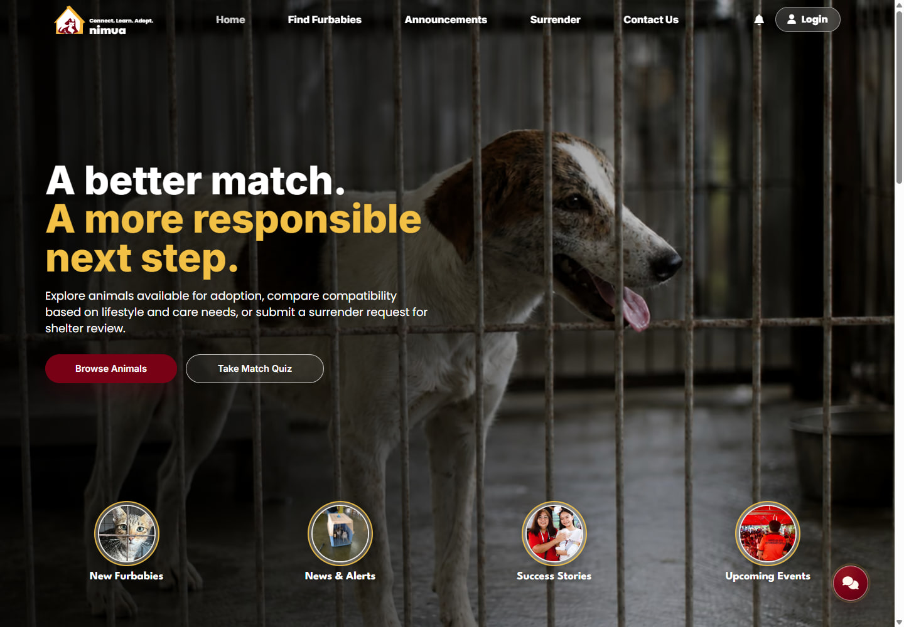
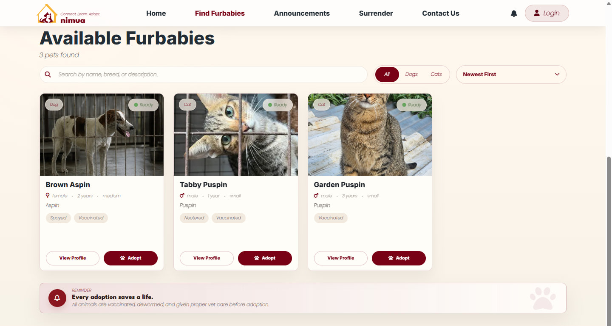
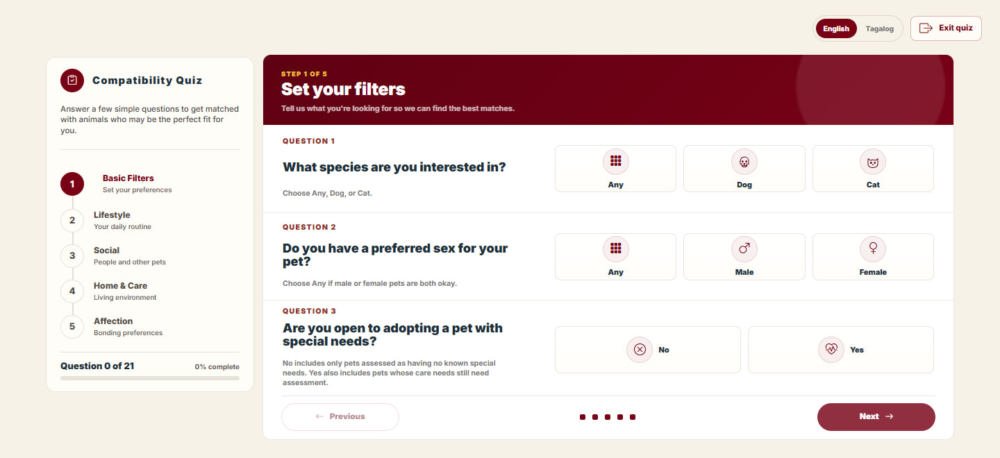
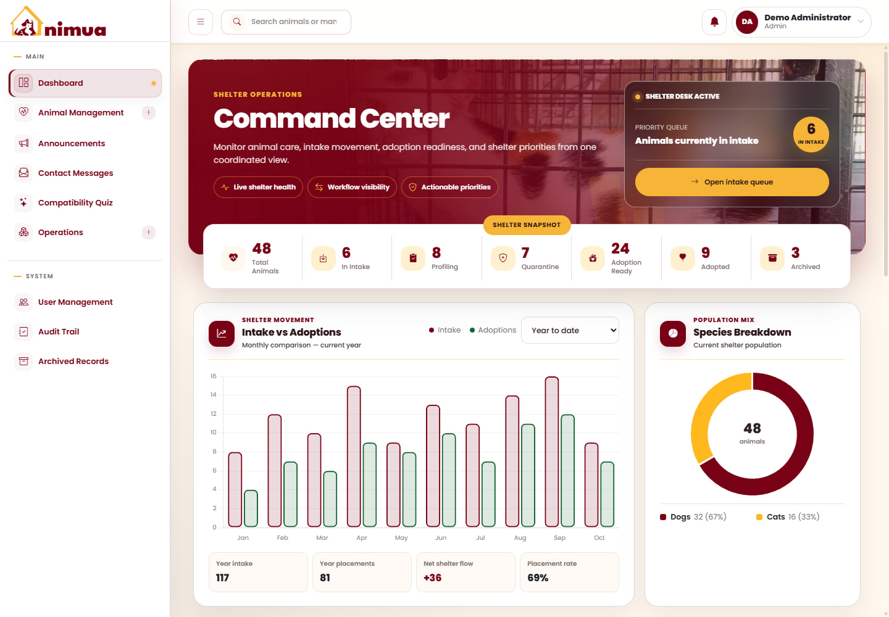
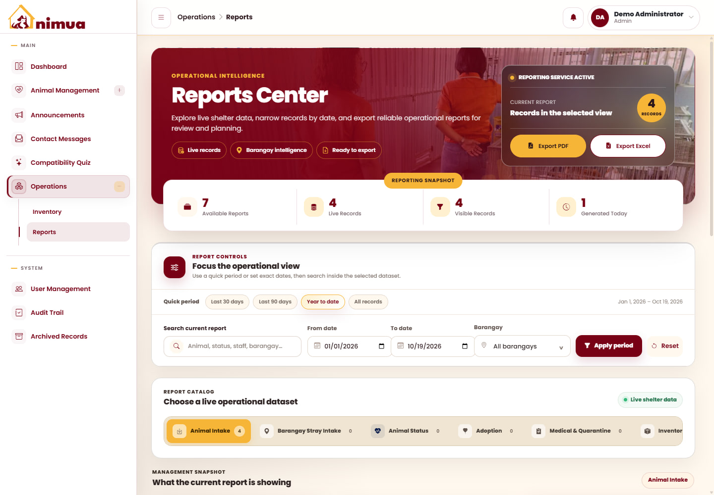

<p align="center">
  
</p>

<h1 align="center">ANIMUA</h1>

<p align="center"><strong>Animal adoption, compatibility matching, and shelter management for Angeles City.</strong></p>

ANIMUA brings the public adoption experience and the daily work of the Angeles City Animal Shelter into one connected system. Residents can discover adoptable dogs and cats, find animals that fit their lifestyle, and follow their adoption or surrender requests. Shelter personnel can manage an animal's journey from intake and assessment through veterinary care and adoption, alongside supplies, community updates, and operational reports.



## Who is it for?

| User | What they can do |
| --- | --- |
| Residents and prospective adopters | Browse shelter animals, take the compatibility quiz, apply to adopt, submit surrender requests, and track submissions. |
| Shelter staff | Handle intake and applications, maintain animal records, manage supplies, publish announcements, and respond to inquiries within their assigned permissions. |
| Veterinarians | Work with medical records, quarantine, assessments, and clearance within their assigned permissions. |
| Administrators | Manage accounts and access, oversee shelter activity, and review reports and audit history. |

## Main features

### Public animal welfare portal

- **Find Furbabies:** browse and search adoptable animals, filter dogs and cats, and view photos, identifying details, health information, and behavioral traits.
- **Pet compatibility quiz:** answer questions in English or Tagalog about lifestyle, household, living space, and care preferences; receive ranked matches and save results to an account.
- **Adoption applications:** submit an application with supporting information and documents, then follow review and pickup progress through My Applications.
- **Surrender requests:** provide animal details, photos, and a surrender reason for shelter review, with request status and appointment tracking.
- **Community updates:** read news and alerts, rescue updates, adoption success stories, and upcoming events.
- **Contact and assistance:** send inquiries, follow conversations with shelter personnel, and use the animal welfare chatbot.

### Shelter management portal

- **Dashboard:** monitor animal population, intake and adoption trends, pending work, and stock alerts.
- **Intake and animal profiles:** record incoming animals, convert intake records into profiles, and maintain photos, behavioral assessments, and adoption readiness.
- **Veterinary care:** record medical history, monitor quarantine, and manage clearance before animals become available for adoption.
- **Adoption and surrender workflows:** review requests, approve or reject applications, coordinate appointments, and finalize handovers.
- **Inventory:** track supplies, stock additions, and consumption, with movement classifications and stockout estimates to support replenishment.
- **Reports:** filter shelter records and download formatted PDF and Excel reports for intake, barangay intake, animal status, adoptions, medical and quarantine activity, inventory usage, and surrender requests.
- **Administration:** control role permissions, manage announcements and contact messages, retain archived records, and inspect the audit trail.

### Matching and decision support

| Component | How it helps |
| --- | --- |
| Compatibility matching | Compares questionnaire answers with animal behavioral and care profiles using cosine similarity and a difference penalty. Eligibility filters account for species, sex, special needs, and adoption readiness. A Python API provides scoring, with a Node.js fallback. |
| Surrender text analysis | Classifies surrender reasons and estimates urgency to help personnel prioritize review. Supports Tagalog and mixed Tagalog-English text through fine-tuned Tagalog RoBERTa models, with fallback classifiers and rules when models or services are unavailable. |
| Inventory forecasting | Uses a Random Forest classifier to identify fast- and slow-moving supplies, alongside stock and usage calculations for estimated stockout risk. |

Recommendations and priority indicators support shelter personnel; adoption approval, medical clearance, and surrender decisions remain part of the management workflow.

## Feature screenshots

These screenshots show the actual application running locally. Animal records, account details, and report figures in the gallery are illustrative demo data.

### Browse adoptable animals

Residents can compare animal profiles and open the application flow from the browsing page.



### English and Tagalog compatibility quiz

The guided quiz collects matching preferences before moving through lifestyle, social environment, home and care, and affection questions.



### Shelter dashboard

The management dashboard brings population counts, operational queues, and shelter activity into one workspace.



### Reports and exports

Personnel can apply reporting periods and filters, review summaries and detailed records, and export PDF or Excel files.



## Technology

| Layer | Technologies |
| --- | --- |
| Public and management frontends | HTML, CSS, JavaScript modules, Vite, Firebase Web SDK, SweetAlert2 |
| Application API | Node.js, Express, Firebase Admin SDK, JWT session authentication |
| Data and files | Cloud Firestore, Firebase Authentication, Firebase Storage |
| Python services | FastAPI, Uvicorn, Pydantic; scikit-learn, PyTorch, and Transformers for surrender analysis |
| Reporting | pdfmake and ExcelJS |
| Validation | Node.js test runner, Vitest, Cypress, and Python tests |
| Deployment configuration | Firebase Hosting for both frontends; Render for the Node API; Cloud Run configuration for Python services |

## Repository layout

```text
animua-revised/
├── frontend/                 # Public adoption and animal welfare portal
├── admin-frontend/           # Shelter management portal
├── backend/                  # Express API, workflows, and Firebase integration
├── backend-python/           # Compatibility scoring API
├── animua-sentiment-service/ # Surrender classification and urgency analysis
├── cypress/                  # Browser functionality and integration checks
├── scripts/                  # Local development and test orchestration
├── docs/screenshots/         # README feature gallery
└── firebase.json             # Hosting and local emulator configuration
```

## Run locally

The repository includes an isolated Firebase emulator workflow using the `demo-animua` project.

### Prerequisites

- Node.js **22.12 or later** and npm.
- **Java JDK 21 or later** for the Firebase emulators.
- Firebase CLI, available as the `firebase` command.
- Python **3.12** if you want to run the optional Python services locally.

### Install and start

```powershell
git clone https://github.com/Calypxo/animua-revised.git
cd animua-revised

npm ci
npm --prefix frontend ci
npm --prefix admin-frontend ci
npm --prefix backend ci

# If the Firebase CLI is not installed:
npm install --global firebase-tools

npm run dev:emulator
```

| Service | Local address |
| --- | --- |
| Public portal | http://127.0.0.1:5173/ |
| Management portal | http://127.0.0.1:5174/ |
| Node API | http://127.0.0.1:5000/ |
| Firebase Emulator UI | http://127.0.0.1:4000/ |

The workflow starts Authentication, Firestore, Storage, the Node backend, and both Vite sites. It creates a local management account: **`admin@animua.test` / `AnimuaDev123!`**. These credentials are for the emulator only; the initial seed creates the account, not a populated shelter dataset.

The sentiment service starts automatically when its local virtual environment is available. See [local Firebase development](FIREBASE_EMULATOR.md) for workflow details.

### Optional Python services

For a local compatibility scorer, create a virtual environment and run the API in a separate terminal:

```powershell
cd backend-python
python -m venv .venv
.\.venv\Scripts\python.exe -m pip install -r requirements.txt
.\.venv\Scripts\python.exe -m uvicorn app:app --host 127.0.0.1 --port 8001
```

Set `PYTHON_MATCHER_URL=http://127.0.0.1:8001/score` in the backend environment before starting it.

For surrender analysis, follow the [Tagalog RoBERTa setup and model guide](animua-sentiment-service/ROBERTA_UPGRADE.md). Model artifacts and Python virtual environments are excluded from Git, so a fresh clone does not include the fine-tuned models. Set `PYTHON_SENTIMENT_API_URL=http://127.0.0.1:8002/analyze-surrender-sentiment` when using the local service.

### Environment configuration

Example configuration files are provided in [backend/.env.example](backend/.env.example), [frontend/.env.example](frontend/.env.example), and [admin-frontend/.env.example](admin-frontend/.env.example).

For a connected Firebase deployment, configure the backend's Firebase credentials, JWT secret, email delivery, and reCAPTCHA settings, plus the frontend API URL and relevant public keys. Chatbot provider keys and management push notifications are optional integrations. Keep private keys, service account files, and populated `.env` files out of version control.

Normal Vite development commands use the configured production Firebase project by default. Use **`npm run dev:emulator`** for the isolated local workflow.

## Build and validation

Build both frontends:

```powershell
npm run build
```

Run the JavaScript unit suites:

```powershell
npm --prefix frontend test
npm --prefix admin-frontend test
npm --prefix backend test

npm --prefix frontend run test:unit
npm --prefix admin-frontend run test:unit
npm --prefix backend run test:unit
```

For browser functionality and integration checks, including the required dedicated test accounts and environment setup, see the [Cypress guide](cypress/README.md) and [Firebase functionality testing guide](FUNCTIONALITY_TESTING_FIREBASE.md).

## More documentation

- [Local Firebase emulator workflow](FIREBASE_EMULATOR.md)
- [Browser testing guide](cypress/README.md)
- [Functionality testing environment](FUNCTIONALITY_TESTING_FIREBASE.md)
- [Surrender model setup and training](animua-sentiment-service/ROBERTA_UPGRADE.md)
- [Independent model evaluation protocol](animua-sentiment-service/evaluation/README.md)
- [Sentiment service deployment](animua-sentiment-service/CLOUD_RUN_DEPLOYMENT.md)
