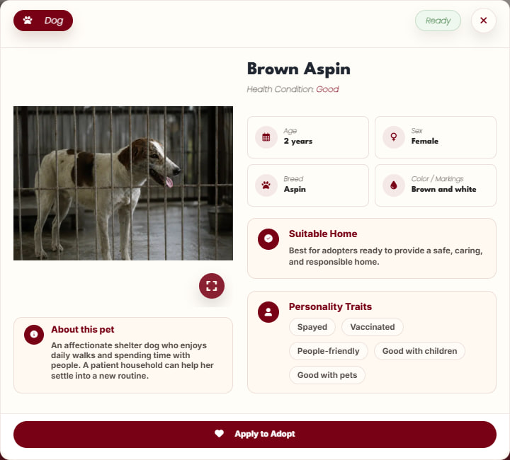
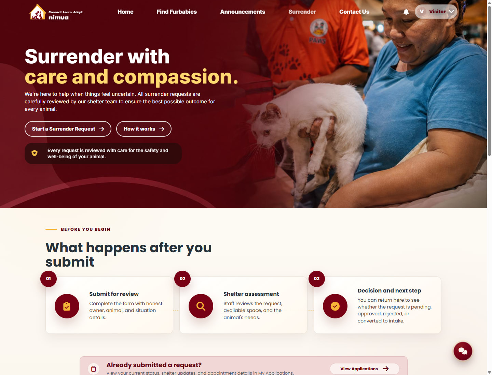
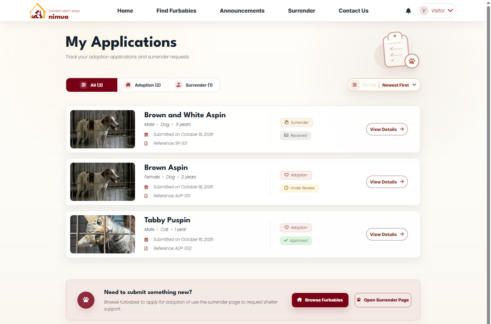
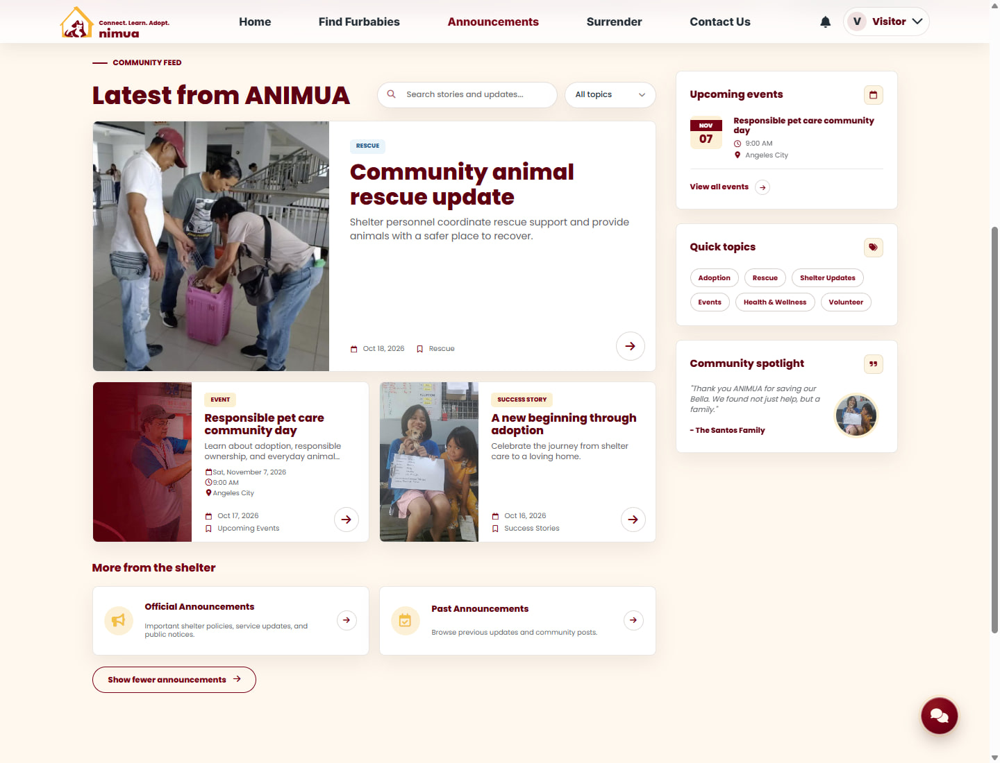
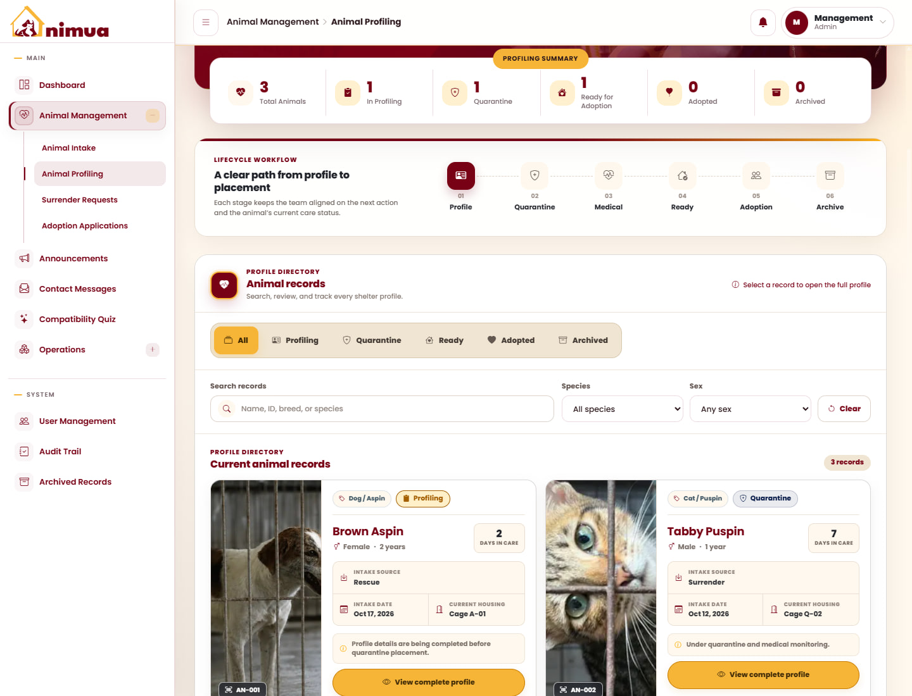
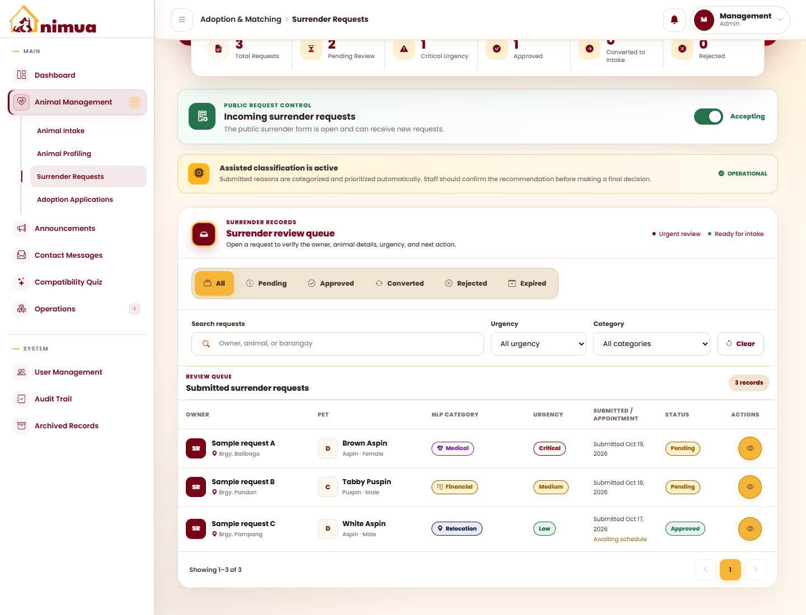
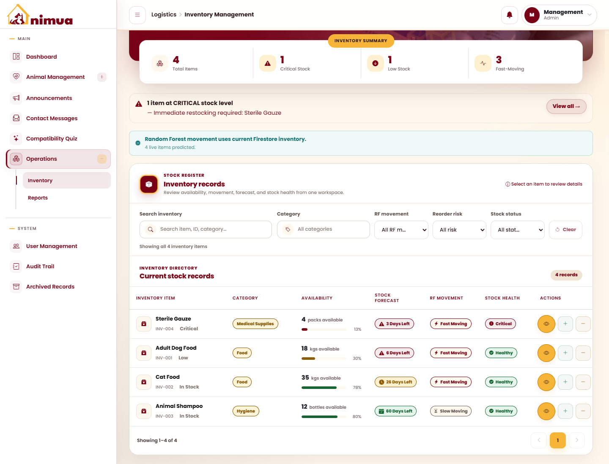

  

<h1 align="center">ANIMUA</h1>

<strong>Connecting responsible adoption with everyday animal shelter care.</strong>

ANIMUA is an animal adoption and shelter management system developed for the Angeles City Veterinary Office. It connects residents looking to adopt or surrender an animal with the shelter personnel responsible for intake, profiling, care, and placement.

The system brings animal information, public requests, and shelter supplies into one place, helping the team follow each animal's journey from arrival to adoption.

## Node.js runtime

Use **Node.js 24.22.1 or a newer 24.x release** for the root tools, backend, public frontend, and management frontend. Version 24.22.1 includes the [CVE-2026-111497 Brotli security fix](https://nodejs.org/en/blog/vulnerability/october-2026-security-releases). The `.node-version` and `.nvmrc` files pin the development runtime; each package rejects unsupported Node versions during npm installation.

Install the patched runtime from [Node.js](https://nodejs.org/en/blog/release/v24.22.1), restart terminals and running Node processes, and confirm `node --version` before installing dependencies or building.

For the Render backend, set any existing `NODE_VERSION` environment variable to `24.22.1` (it overrides repository version files), then redeploy and confirm the Node version in the build logs. Update Node on any other build or hosting environment and restart or redeploy its services as well. Updating repository files alone does not patch an already running server. See [Render's Node version settings](https://render.com/docs/node-version).

## Public portal

### Home page

The home page introduces ANIMUA and gives residents a starting point for browsing animals, taking the compatibility quiz, reading shelter updates, and learning about the adoption process. Featured stories connect visitors with new furbabies, rescue updates, success stories, and upcoming events.

### Find Furbabies and adoption

Residents can search adoptable dogs and cats, filter by species, and view photos, identifying details, health information, and behavioral traits. Each profile provides a closer look at the animal and an entry point to the adoption application, where applicants can provide supporting information and documents for shelter review.

View animal browsing and profile screenshots

**Browse adoptable animals**

**Explore an animal's profile**

### Pet compatibility quiz

The guided quiz is available in English and Tagalog. It considers lifestyle, household, living space, and care preferences to recommend suitable shelter animals. Residents can revisit saved results and use their recommendations when exploring adoption options.

View the compatibility quiz

### Surrender requests and My Applications

- **Surrender page:** explains the shelter review process and lets residents provide animal details, photos, and a surrender reason. Requests are reviewed according to the animal's needs and shelter availability.
- **My Applications:** brings adoption and surrender submissions together, with status updates, reference numbers, request details, and appointment or pickup information when applicable.

View surrender guidance and application tracking

**Surrender guidance**

**My Applications**

### Announcements and assistance

The announcements page shares news and alerts, rescue updates, adoption success stories, and upcoming events. Visitors can search posts and filter by topic. Contact conversations let residents follow up with shelter personnel, while the animal welfare chatbot provides another way to ask for guidance.

View announcements and upcoming events

## Management portal

### Animal profiling

Record incoming animals and convert intake records into profiles. Maintain identifying details, photos, intake source, housing, and care status. Behavioral assessments, medical records, quarantine monitoring, and veterinary clearance help personnel determine readiness for adoption.

### Surrender management

Review incoming surrender requests, animal information, and surrender reasons. Category and urgency indicators help personnel prioritize review, coordinate appointments, and move approved requests into intake.

### Inventory management

Monitor food, medicine, and other shelter supplies. Track stock additions and usage, identify low stock, and review movement forecasts and estimated stockout risk to support replenishment.

### Adoption coordination and daily operations

Shelter personnel review adoption applications, coordinate pickup, and finalize placements. Dashboard summaries, PDF and Excel reports, announcements, contact messages, archived records, and audit history support the team's daily work. Management access follows assigned roles and permissions.

## How the portals work together

A surrender approved by the shelter can become an intake record and then an animal profile. Personnel complete assessments and care before marking the animal ready for adoption. Residents can then discover the animal, explore compatibility, and submit an application, while shelter personnel manage review and placement.

*Screenshots show illustrative animal, application, community, and inventory records.*
